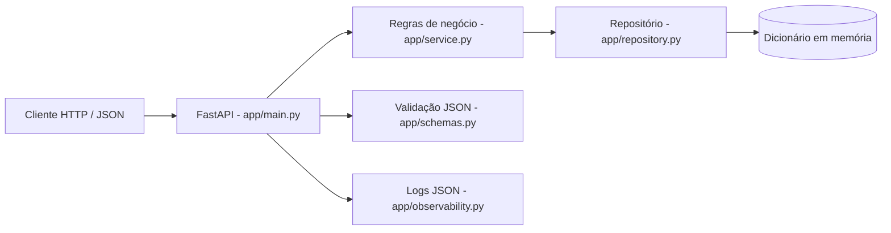

# CP5 — SOA | API REST de Pedidos

Projeto da disciplina **Arquitetura Orientada a Serviço (SOA)** da FIAP — turma **3ESPY**, 2º semestre de 2026. Atividade CP5 de 21/10/2026, proposta pela Profa. Damiana Costa.

## Integrantes

| Nome completo | RM |
| --- | --- |
| Henrique Sanches | RM557959 |
| João Pedro Kraide Máximo | RM563166 |
| Douglas dos Santos Melo | RM556439 |
| Nicolas Caciolato reis | RM556506 |
| Matheus Marcelino Dantas da Silva | RM556332 |

## Objetivo e escopo

Disponibilizar uma API REST para **criar pedidos** e **consultar pedidos pelo identificador**, de acordo com o enunciado do CP5. Cada pedido contém identificador único (UUID), cliente, descrição, valor e status `CRIADO`.

- **Persistência:** dicionário em memória (sem banco de dados externo).
- **Formato:** JSON nas requisições e respostas.
- **Retornos:** `201` para criação, `200` para consulta, `404` para pedido inexistente e `422` para dados inválidos.
- **Sem autenticação, mensageria ou CRUD extra**, conforme o escopo solicitado.

> **Atenção:** os pedidos armazenados são perdidos quando o servidor é reiniciado. A aplicação foi construída para executar como um único processo, pois a persistência é local à memória do processo.

## Tecnologias

- Python **3.10+**
- FastAPI e Pydantic: API, validações e documentação OpenAPI
- Uvicorn: servidor HTTP
- Pytest + HTTPX / TestClient: testes automatizados
- Logging padrão do Python: logs estruturados em JSON

## Como executar

Na pasta raiz do projeto:

```bash
python -m venv .venv
```

Ative o ambiente virtual:

**Windows (PowerShell)**

```powershell
.venv\Scripts\Activate.ps1
```

**Linux/macOS**

```bash
source .venv/bin/activate
```

Instale as dependências e inicie a API:

```bash
python -m pip install -r requirements.txt
python -m uvicorn app.main:app --reload
```

Acesse:

- **Swagger UI:** http://127.0.0.1:8000/docs
- **OpenAPI em JSON (dinâmico):** http://127.0.0.1:8000/openapi.json
- **Especificação OpenAPI versionada:** [`docs/openapi.json`](docs/openapi.json)

## Endpoints

| Operação | Método e rota | Dados de entrada | Respostas principais |
| --- | --- | --- | --- |
| Criar um pedido | `POST /pedidos` | Corpo JSON com `cliente`, `descricao`, `valor` | `201 Created`, `422 Unprocessable Entity` |
| Consultar pelo ID | `GET /pedidos/{pedido_id}` | UUID na URL | `200 OK`, `404 Not Found`, `422 Unprocessable Entity` |

O corpo JSON de criação exige `cliente` e `descricao` com texto não vazio e `valor` numérico maior que zero. O servidor atribui automaticamente o UUID e o status `CRIADO`. A criação também retorna o cabeçalho `Location` apontando para o pedido; ambas as operações retornam `X-Request-ID` para identificação da requisição nos logs.

## Exemplos de requisição e resposta

### 1. Criar pedido

```bash
curl -i -X POST "http://127.0.0.1:8000/pedidos" \
  -H "Content-Type: application/json" \
  -d '{"cliente":"Maria Silva","descricao":"Teclado mecânico","valor":249.90}'
```

**HTTP 201 — Exemplo real de resposta da execução de evidência:**

```json
{
  "cliente": "Maria Silva",
  "descricao": "Teclado mecânico",
  "valor": 249.9,
  "id": "ab57e469-70cd-40f1-a940-2fc017e27045",
  "status": "CRIADO"
}
```

O identificador muda em cada criação porque é gerado com UUID v4.

### 2. Consultar pedido

Copie o `id` obtido na criação e substitua `<ID_DO_PEDIDO>` no comando:

```bash
curl -i "http://127.0.0.1:8000/pedidos/<ID_DO_PEDIDO>"
```

**HTTP 200:** retorna o mesmo JSON do pedido criado, com os campos `id`, `cliente`, `descricao`, `valor` e `status`.

**HTTP 404:** ao consultar um UUID que não esteja na memória:

```json
{
  "detail": "Pedido não encontrado."
}
```

**HTTP 422:** ao enviar dados inválidos para a criação, a API retorna um JSON com `detail` descrevendo os campos que não passaram na validação.

Amostras das chamadas executadas de verdade estão em [`docs/evidencias/respostas.json`](docs/evidencias/respostas.json).

## Arquitetura e System Design



**Responsabilidades dos componentes:**

1. **Entrada HTTP (`app/main.py`):** expõe as rotas REST, lê e devolve JSON, trata resposta `404` e atribui `X-Request-ID`.
2. **Contratos (`app/schemas.py`):** valida os campos de entrada e define o modelo de resposta, incluindo o status `CRIADO`.
3. **Serviço (`app/service.py`):** gera o UUID do pedido, define seu status inicial e coordena salvamento e consulta.
4. **Repositório (`app/repository.py`):** mantém os pedidos em um dicionário Python, sem persistência externa.
5. **Observabilidade (`app/observability.py`):** produz um evento JSON por criação ou consulta e registra consultas inexistentes como `WARNING`.

Esse diagrama é renderizado automaticamente pelo GitHub no README; não depende de ferramentas externas.

## Testes automatizados — evidência de execução

Execute na raiz do projeto:

```bash
python -m pytest -q
```

Casos implementados em [`tests/test_pedidos.py`](tests/test_pedidos.py): criação com HTTP 201 e dados corretos; consulta de pedido existente com HTTP 200; consulta inexistente com HTTP 404; validação de entrada com HTTP 422; e formatação de um log JSON com identificador de requisição e pedido.

**Resultado obtido na execução do projeto:**

```text
.....                                                                    [100%]
5 passed in 0.30s
```

A saída foi preservada em [`docs/evidencias/testes.txt`](docs/evidencias/testes.txt).

## Observabilidade — logs estruturados

Os logs são produzidos no terminal que executa a aplicação e possuem `timestamp` UTC, `level`, `operacao`, `mensagem`, `requestId` e `pedidoId`. A ausência de pedido gera `WARNING` com o mesmo padrão JSON. Não há dependência de ferramenta externa de observabilidade.

**Exemplo real produzido na execução da API:**

```json
{"timestamp": "2026-10-22T00:39:01.890Z", "level": "INFO", "operacao": "criar_pedido", "mensagem": "Pedido criado com sucesso", "requestId": "cd46b592-62be-416f-9614-a4a2ae4e394d", "pedidoId": "ab57e469-70cd-40f1-a940-2fc017e27045"}
```

**Evidência completa de criação, consulta com sucesso e consulta sem resultado:** [`docs/evidencias/logs.jsonl`](docs/evidencias/logs.jsonl). Cada linha desse arquivo é um objeto JSON independente. Para reproduzir, inicie a API e faça as chamadas da seção de exemplos.

## Estrutura do repositório

```text
cp5-soa-pedidos/
├── app/
│   ├── __init__.py
│   ├── main.py             # Rotas REST e middleware do request ID
│   ├── schemas.py          # Modelos de entrada e saída
│   ├── service.py          # Regras de negócio
│   ├── repository.py       # Dicionário de pedidos em memória
│   └── observability.py    # Logs em JSON
├── tests/
│   └── test_pedidos.py     # 5 testes automatizados
├── docs/
│   ├── openapi.json        # Documentação OpenAPI gerada
│   └── evidencias/
│       ├── testes.txt      # Resultado real do Pytest
│       ├── logs.jsonl      # Eventos reais gerados pela API
│       └── respostas.json  # Respostas reais HTTP/JSON
├── requirements.txt
├── .gitignore
└── README.md
```

## Verificação dos critérios do CP5

| Critério | Entrega correspondente | Pontos previstos |
| --- | --- | ---: |
| Arquitetura e System Design | Diagrama Mermaid e descrição dos componentes neste README | 2,0 |
| OpenAPI / Swagger | `docs/openapi.json` e `/docs` | 2,0 |
| Implementação da API | `POST /pedidos` e `GET /pedidos/{pedido_id}` | 2,0 |
| Teste automatizado | `tests/test_pedidos.py` e `docs/evidencias/testes.txt` | 2,0 |
| Observabilidade | `app/observability.py` e `docs/evidencias/logs.jsonl` | 2,0 |
| **Total possível** | **Todos os itens exigidos estão contemplados** | **10,0** |

**Entrega:** publique a pasta do projeto em um repositório público no GitHub e envie o link na atividade da disciplina. Os **10,0 pontos** são o valor total da rubrica, não uma nota garantida.
# cp5-soa

