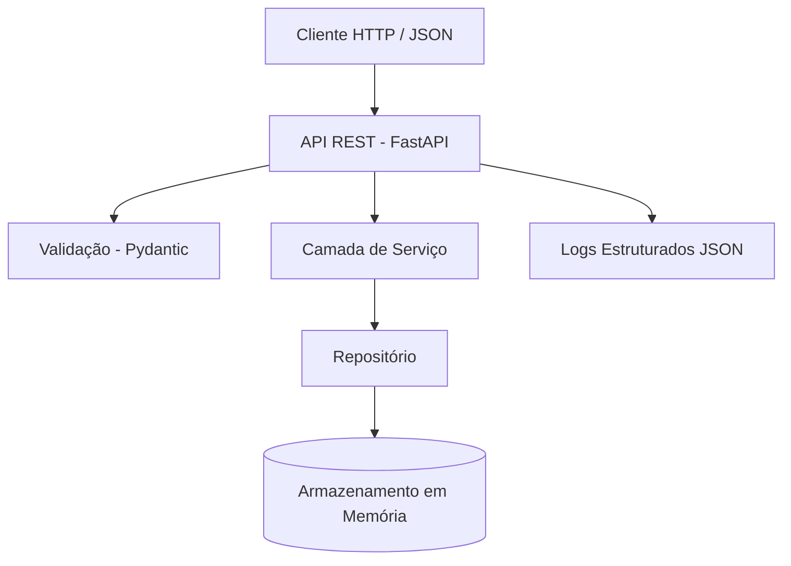

# CP5 — SOA | API REST de Pedidos

Projeto desenvolvido para a disciplina **Arquitetura Orientada a Serviço (SOA)** da FIAP.

**Turma:** 3ESPY  
**Semestre:** 2º semestre de 2026  
**Professora:** Damiana Costa  
**Avaliação:** Checkpoint 5 — 21/10/2026

---

## Integrantes

| Nome completo | RM |
|---|---|
| João Pedro Kraide Máximo | RM563166 |
| Nicolas Caciolato Reis | RM556506 |


## Objetivo

Desenvolver uma API REST para gerenciamento de pedidos de uma empresa de comércio eletrônico, permitindo criar pedidos e consultá-los por identificador.

Cada pedido possui:

- Identificador único (UUID)
- Nome do cliente
- Descrição do pedido
- Valor do pedido
- Status inicial `CRIADO`

A aplicação utiliza armazenamento em memória, sem necessidade de banco de dados externo.

## Tecnologias utilizadas

- **Python 3.10+** — Linguagem de programação
- **FastAPI** — Desenvolvimento da API REST
- **Pydantic** — Validação dos dados
- **Uvicorn** — Servidor HTTP
- **Pytest** — Testes automatizados
- **HTTPX** — Cliente HTTP para testes
- **OpenAPI / Swagger** — Documentação da API
- **Logging** — Logs estruturados em JSON

## Como executar o projeto

### 1. Criar o ambiente virtual

```bash
python -m venv .venv
```

### 2. Ativar o ambiente virtual

Windows (CMD):

```cmd
.venv\Scripts\activate.bat
```

Windows (PowerShell):

```powershell
.venv\Scripts\Activate.ps1
```

Linux/macOS:

```bash
source .venv/bin/activate
```

### 3. Instalar as dependências

```bash
python -m pip install -r requirements.txt
```

### 4. Iniciar a aplicação

```bash
python -m uvicorn app.main:app --reload
```

A aplicação estará disponível em:

**http://127.0.0.1:8000**

Documentação Swagger:

**http://127.0.0.1:8000/docs**

Especificação OpenAPI:

**http://127.0.0.1:8000/openapi.json**

O projeto também possui uma especificação versionada em `docs/openapi.json`.

---

## Endpoints da API

| Método | Endpoint | Descrição | Status |
|---|---|---|---|
| POST | `/pedidos` | Criar um pedido | 201 |
| GET | `/pedidos/{pedido_id}` | Consultar pedido por ID | 200 |
| GET | `/pedidos/{pedido_id}` | Pedido inexistente | 404 |
| POST | `/pedidos` | Dados inválidos | 422 |

### Criar um pedido

**Requisição:**

```http
POST /pedidos
Content-Type: application/json
```

**Corpo JSON:**

```json
{
  "cliente": "Maria Silva",
  "descricao": "Teclado mecânico",
  "valor": 249.90
}
```

**Resposta — HTTP 201 Created:**

```json
{
  "cliente": "Maria Silva",
  "descricao": "Teclado mecânico",
  "valor": 249.9,
  "id": "ab57e469-70cd-40f1-a940-2fc017e27045",
  "status": "CRIADO"
}
```

O identificador é gerado automaticamente utilizando UUID v4.

O valor precisa ser maior que zero, e os campos de texto não podem estar vazios.

### Consultar um pedido

**Requisição:**

```http
GET /pedidos/{pedido_id}
```

**Exemplo:**

```http
GET /pedidos/ab57e469-70cd-40f1-a940-2fc017e27045
```

**Resposta — HTTP 200 OK:**

```json
{
  "cliente": "Maria Silva",
  "descricao": "Teclado mecânico",
  "valor": 249.9,
  "id": "ab57e469-70cd-40f1-a940-2fc017e27045",
  "status": "CRIADO"
}
```

### Tratamento de erros

Caso o pedido não exista, a API retorna:

**HTTP 404 Not Found**

```json
{
  "detail": "Pedido não encontrado."
}
```

Dados inválidos retornam HTTP 422, com detalhes sobre os campos que não passaram na validação.

Exemplos adicionais de respostas estão disponíveis em `docs/evidencias/respostas.json`.

---

## Arquitetura e System Design

A aplicação foi organizada em camadas para separar as responsabilidades de cada componente.



### Responsabilidades dos componentes

**1. Camada HTTP — `app/main.py`**

Responsável por receber as requisições, disponibilizar os endpoints REST, retornar respostas JSON e controlar os códigos HTTP.

**2. Modelos — `app/schemas.py`**

Define a estrutura dos pedidos e realiza a validação dos dados utilizando Pydantic.

**3. Serviço — `app/service.py`**

Contém as regras de negócio, gera os identificadores únicos e coordena a criação e a consulta dos pedidos.

**4. Repositório — `app/repository.py`**

Responsável pelo armazenamento e pela recuperação dos pedidos utilizando um dicionário Python em memória.

**5. Observabilidade — `app/observability.py`**

Responsável pela geração dos logs estruturados em JSON, registrando as operações realizadas pela API.

### Persistência dos dados

Os pedidos são armazenados em memória durante a execução da aplicação.

Quando o servidor é reiniciado, os dados são perdidos. Esse comportamento atende ao requisito do checkpoint de não utilizar um banco de dados externo.

---

## Documentação OpenAPI / Swagger

A API possui documentação OpenAPI, permitindo consultar os endpoints, os modelos de dados e os possíveis códigos de resposta.

A documentação pode ser acessada por meio do Swagger UI:

**http://127.0.0.1:8000/docs**

Também está disponível no arquivo:

`docs/openapi.json`

As duas operações obrigatórias estão documentadas:

- `POST /pedidos`
- `GET /pedidos/{pedido_id}`

---

## Testes automatizados

Os testes foram implementados utilizando Pytest e FastAPI TestClient.

### Executar os testes

Na pasta raiz do projeto:

```bash
python -m pytest -q
```

### Cenários testados

1. Criação de pedido com sucesso — HTTP 201.
2. Consulta de pedido existente — HTTP 200.
3. Consulta de pedido inexistente — HTTP 404.
4. Validação de dados inválidos — HTTP 422.
5. Verificação da estrutura de um log JSON.

### Evidência de execução

Resultado registrado na execução do projeto:

```text
.....                                                                    [100%]
5 passed in 0.30s
```

Os testes estão implementados em:

`tests/test_pedidos.py`

A evidência da execução está disponível em:

`docs/evidencias/testes.txt`

---

## Observabilidade — Logs estruturados

A API implementa logs estruturados em formato JSON para registrar operações importantes.

Cada registro contém:

- `timestamp` — Data e hora da operação
- `level` — Nível do log
- `operacao` — Operação executada
- `mensagem` — Descrição do evento
- `requestId` — Identificador da requisição
- `pedidoId` — Identificador do pedido

### Exemplo de log

```json
{
  "timestamp": "2026-10-22T00:39:01.890Z",
  "level": "INFO",
  "operacao": "criar_pedido",
  "mensagem": "Pedido criado com sucesso",
  "requestId": "cd46b592-62be-416f-9614-a4a2ae4e394d",
  "pedidoId": "ab57e469-70cd-40f1-a940-2fc017e27045"
}
```

Operações de consulta a pedidos inexistentes são registradas com nível `WARNING`.

As evidências estão disponíveis em:

`docs/evidencias/logs.jsonl`

---

## Estrutura do projeto

```text
cp5-soa-pedidos/
│
├── app/
│   ├── __init__.py
│   ├── main.py
│   ├── schemas.py
│   ├── service.py
│   ├── repository.py
│   └── observability.py
│
├── tests/
│   └── test_pedidos.py
│
├── docs/
│   ├── openapi.json
│   └── evidencias/
│       ├── testes.txt
│       ├── logs.jsonl
│       └── respostas.json
│
├── requirements.txt
├── .gitignore
└── README.md
```

---

## Critérios de avaliação — CP5

| Critério | Implementação | Pontuação |
|---|---|---|
| Arquitetura e System Design | Diagrama Mermaid e separação em camadas | 2,0 |
| OpenAPI / Swagger | Documentação dos endpoints | 2,0 |
| Implementação da API | Criação e consulta de pedidos | 2,0 |
| Testes automatizados | Pytest com evidência de execução | 2,0 |
| Observabilidade | Logs estruturados em JSON | 2,0 |
| **Total possível** | **5 critérios contemplados** | **10,0** |

## Entrega

O projeto deve ser disponibilizado em um repositório público no GitHub, contendo o código-fonte, a documentação, os testes automatizados e as evidências de execução.

**FIAP — Engenharia de Software — 2026**
